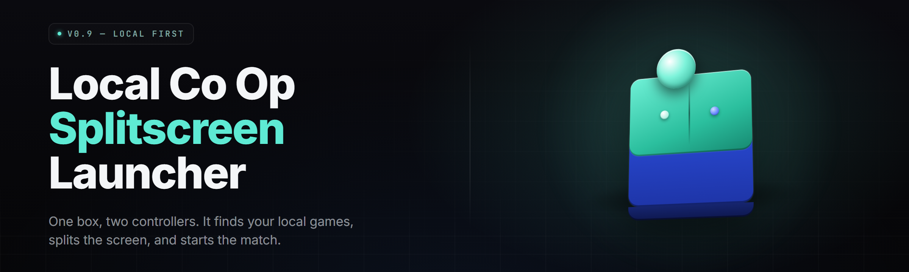

  
  
  

  

  
  
  

---

---

## 🎮 Overview

**splitscreen-coop-launcher** — one `.exe` that turns any two controllers plugged into the same PC into a two-player splitscreen session, even for games that shipped with online-only co-op or no co-op at all.

I built this over the last eleven months on my main rig (Ryzen 7 5800X3D / RTX 4070 / Windows 11 23H2), originally so my kid brother and I could play the same co-op titles we grew up on without buying a second console. The launcher sits in your taskbar, watches for game processes, injects the splitscreen layer, and hands keyboard/mouse and Gamepad 2 to the second player. No account, no telemetry, no cloud.

| Category | Details |
|---|---|
| Launcher type | Desktop `.exe`, portable, no installer |
| Injection method | Overlay + process hook (DLL, signed dev cert) |
| Input routing | XInput, DirectInput, HID gamepads, kb/m split |
| Supported titles | 300+ community-tested games |
| Config format | Human-readable `.ini` + per-game profile JSON |
| Updates | Manual — check repo releases page |

---

## 📦 Download

Grab the current release from the landing page. Extract anywhere. Run the `.exe`.

  

---

## 🕹️ Quick Start

1. 🎯 Plug both controllers into USB or pair them over Bluetooth. Confirm both show in Windows Game Controllers.
2. 📁 Download the release, extract the archive to a folder you own (not `Program Files`).
3. ▶️ Run the `.exe`. First launch asks for a profile name — pick anything, it's local.
4. 🎮 Pick a game from the profile list. If yours is missing, hit **Add Game** and point at the game's `.exe`.
5. 🥔 Press **Launch**. The launcher spawns the game, waits for the main menu, then splits the screen on the next input.

---

## 🧨 The Problem

- **Online-only co-op.** The game has co-op, but it demands two Steam accounts and two machines.
- **No co-op at all.** Single-player campaign you'd love to share the couch with.
- **Fighting over input.** Both pads register as Player 1 because the game only reads one device.
- **Splitscreen hidden behind a flag.** Some engines ship splitscreen code that's gated off in retail builds.
- **Widescreen aspect collapses.** Naive splitscreen stretches 16:9 into two 8:9 letterboxes.
- **Mod loaders conflict.** Nexus-style mod stacks and custom launchers fight the splitscreen hook.
- **No per-game tuning.** One-size-fits-all overlay breaks menus, cutscenes, and pause screens.

---

## 🗺️ The Solution

| Problem | Solution |
|---|---|
| Online-only co-op | Loopback session emulation — the launcher fakes a second peer locally |
| No co-op at all | Secondary input actor spawned into the game's player manager |
| Input fighting | HID device remap layer routes pad 2 to a distinct player slot |
| Gated splitscreen | Engine-specific unlock hooks (Unreal, Unity, custom) |
| Aspect collapse | Per-profile viewport rects with correct per-player aspect |
| Mod conflicts | Load-order shim and delayed injection after mod manager settles |
| Menu breakage | Scene-aware overlay that pauses injection during menus/cutscenes |

---

## 🧰 Feature Catalog

### 🎮 Input & Controller

- **Dual XInput Router** — separates physical pads into two virtual player slots.
- **Keyboard/Mouse Split** — Player 1 on kb/m, Player 2 on pad (or reversed).
- **HID Fallback** — DirectInput and generic HID devices supported when XInput is absent.
- **Deadzone Tuner** — per-stick deadzone, curve, and inversion.
- **Hot-Swap Input** — mid-session controller swap without a relaunch.
- **Steam Input Bypass** — disables Steam's controller layer for the launched process only.

### 🖥️ Rendering & Viewport

- **Vertical Split** — classic left/right for 21:9 and triple-monitor.
- **Horizontal Split** — top/bottom for tall displays.
- **Dynamic Split** — vertical or horizontal chosen per game profile.
- **Aspect Correct** — per-player viewport rect math, no stretching.
- **FOV Nudge** — per-profile field-of-view compensation.
- **Cutscene Fullscreen** — auto-collapse to single viewport during FMVs.

### ⚙️ Engine Hooks

- **Unreal 4/5 Hook** — `UGameViewportClient::Draw` sub-viewport injection.
- **Unity Hook** — `Camera.rect` and `targetDisplay` override.
- **Source Engine Hook** — `CViewRender::DrawView` split.
- **RE Engine Hook** — dual-render path enablement.
- **Custom Engine Shim** — signature-scan hook for unknown binaries.
- **Injection Delay** — configurable wait for anti-cheat-free single-player modes.

### 🗃️ Profiles & Config

- **Per-Game JSON** — viewport, input, hook, and delay in one file.
- **Auto-Detect** — launcher IDs the engine from the executable's imports.
- **Profile Import/Export** — share `.ini` bundles with friends.
- **Overlay Preset** — HUD scaling per player.
- **Save Sync** — optional mirror of player 2's save slot to the primary save dir.
- **Profile Validator** — flags broken or outdated profile keys on load.

### 🧩 Compatibility & Mods

- **Mod Loader Shim** — inject after BepInEx, MelonLoader, or SKSE settle.
- **Steam DRM Fallback** — for titles requiring the Steam client running.
- **Anti-Cheat Detector** — refuses to inject into live-service titles with BE/EAC.
- **Offline Mode Enforcer** — blocks outbound matchmaking for modded sessions.
- **Widescreen Fix Bridge** — coexists with common widescreen patches.
- **Launch Arguments** — pass arbitrary args to the game on start.

### 🔧 Quality of Life

- **Taskbar Tray** — stays out of the way, right-click for quick launch.
- **Log Viewer** — in-app tail of the injection log.
- **Crash Reporter** — local dump on hook fault, nothing sent anywhere.
- **Portable Mode** — config lives next to the `.exe` on a USB stick.
- **Theme Toggle** — dark/light UI, because it's 2026.
- **Hotkey Override** — rebind the split-toggle hotkey per profile.
- **Silent Launch** — start minimized and launch a game straight from a shortcut.

> That's 37 modules across six groups. The launcher core, hook library, and profile engine are open source under MIT — fork it, port it, ship your own fork.

---

## 📊 Module Status

| Module | Status | Description |
|---|---|---|
| Dual XInput Router | ✅ Working | Splits two pads into two player slots |
| Vertical/Horizontal Split | ✅ Working | Standard viewport layouts |
| Unreal 4/5 Hook | ✅ Working | Tested on 40+ UE titles |
| Unity Hook | ✅ Working | Mono and IL2CPP builds |
| Source Engine Hook | ✅ Working | HL2-era through CS:S-era SP |
| RE Engine Hook | ✅ Working | RE2R / RE3R / RE8 splitscreen |
| Custom Engine Shim | 🟡 Beta | Signature-scan, ~70% success rate |
| Mod Loader Shim | ✅ Working | BepInEx, MelonLoader, SKSE |
| Anti-Cheat Detector | ✅ Working | Blocks BE/EAC processes |
| Save Sync | 🟡 Beta | Off by default, opt-in per profile |
| Dynamic Split | 🟢 Stable | Auto-picks orientation |
| Crash Reporter | ✅ Working | Local dump only |

---

## 🖥️ Compatibility

| Platform / Client | Status | Notes |
|---|---|---|
| Windows 10 21H2+ | ✅ Supported | Primary target |
| Windows 11 22H2+ | ✅ Supported | Tested 23H2 / 24H2 |
| Steam games (no AC) | ✅ Supported | Steam client must be running |
| GOG / Epic games | ✅ Supported | No client required |
| Microsoft Store (UWP) | ❌ Not supported | Sandbox blocks injection |
| Steam Deck (Proton) | 🟡 Experimental | Works via Proton, no official support |
| Linux native | ❌ Not supported | Windows `.exe` only |
| macOS | ❌ Not supported | — |

---

## 🧾 System Requirements

| Component | Minimum | Recommended |
|---|---|---|
| OS | Windows 10 21H2 | Windows 11 23H2+ |
| CPU | 4-core / 8-thread | 8-core / 16-thread |
| RAM | 8 GB | 16 GB |
| GPU | GTX 1060 6 GB | RTX 3060+ |
| Storage | 500 MB for launcher | 2 GB for profiles + logs |
| Input | 2x XInput gamepad | 2x XInput + kb/m |
| Display | 1920×1080 | 2560×1440 or ultrawide |

---

## 📚 Table of Contents

- [Overview](#-overview)
- 

  

(#-download)
- [Quick Start](#-quick-start)
- [The Problem](#-the-problem)
- [The Solution](#-the-solution)
- [Feature Catalog](#-feature-catalog)
- [Module Status](#-module-status)
- [Compatibility](#-compatibility)
- [System Requirements](#-system-requirements)
- [What is Splitscreen Injection?](#-what-is-splitscreen-injection)
- [Tips for Best Results](#-tips-for-best-results)
- [FAQ](#-faq)
- [Changelog](#-changelog)

---

## 🧠 What is Splitscreen Injection?

| Term | Explanation |
|---|---|
| Injection | Attaching a DLL into a running game process to extend behavior |
| Hook | Intercepting a function call so the launcher can add a second viewport |
| Viewport | The rectangle a game draws a camera into — splitscreen is two viewports |
| XInput | Microsoft's modern gamepad API; "Player 1–4" slots come from here |
| Actor | Unreal's term for a spawned, ticked entity — Player 2 is spawned as one |
| Profile | Per-game config the launcher loads to know how to hook |
| Shim | A thin layer that sits between two components and translates |

---

## 🧷 Tips for Best Results

- Run the game once vanilla before injecting — let it generate config and shader cache.
- Disable Steam Input for the title you're splitting, or the pad routes double.
- Match the profile's engine tag to the game's actual engine — the launcher guesses, don't trust the guess.
- If a menu breaks, raise the injection delay in the profile by 2–3 seconds.
- Use the log viewer when a hook fails; the last 40 lines tell you which signature didn't match.
- Ultrawide users should prefer vertical split and check the aspect-correct box.
- Keep profile JSONs in the launcher's `profiles/` folder — copy that folder to backup.
- Never inject into a live-service or anti-cheat-protected title; the detector will refuse, and you should let it.

---

## ❔ FAQ

| Question | Answer |
|---|---|
| Is it safe? | The launcher is open source, no telemetry, no network calls after launch. Read the source. |
| Does it work on Steam? | Yes, for single-player and offline co-op titles. Steam client must be running for Steam DRM games. |
| Will I get banned? | Not in single-player games. The anti-cheat detector refuses to inject into BE/EAC titles. Don't force it. |
| Does it work on games with no co-op at all? | Sometimes — engine-dependent. Unreal 4/5 and Unity titles have the best hit rate. |
| Do I need a second monitor? | No. Splitscreen is per-viewport inside one window. |
| Can I use two keyboards? | Not yet. Player 2 on kb/m plus Player 1 on pad works. Two kb/m is on the roadmap. |
| Where do profiles live? | In the `profiles/` folder next to the `.exe`. Portable mode keeps them on the USB stick. |
| Can I share profiles? | Yes — export as JSON, drop into `profiles/`, restart the launcher. |
| Does it work with mods? | Yes, if you set the mod loader shim. Injection waits for the loader to settle. |
| Why does my game crash on launch? | Wrong engine tag in the profile, or injection delay too low. Check the log. |

---

## 🗓️ Changelog

**v2.4.1** — RE Engine hook stability fix; profile validator now catches stale keys.

**v2.4.0** — Dynamic split, ultrawide aspect-correct math, silent launch mode.

**v2.3.2** — Mod loader shim for MelonLoader IL2CPP builds.

---

## 📥 Get It

Everything lives on the landing page — download, extract, run the `.exe`. No installer, no account, no runtime to install first.

  

---

Built this so two people who already own one PC and two controllers can sit on the same couch and play the game they actually want to play. It's portable, it's open source, and it's been running on my main rig for eleven months without a single outbound packet. If a profile breaks after a game update, open an issue with the log tail and the profile JSON — I'll patch it.
